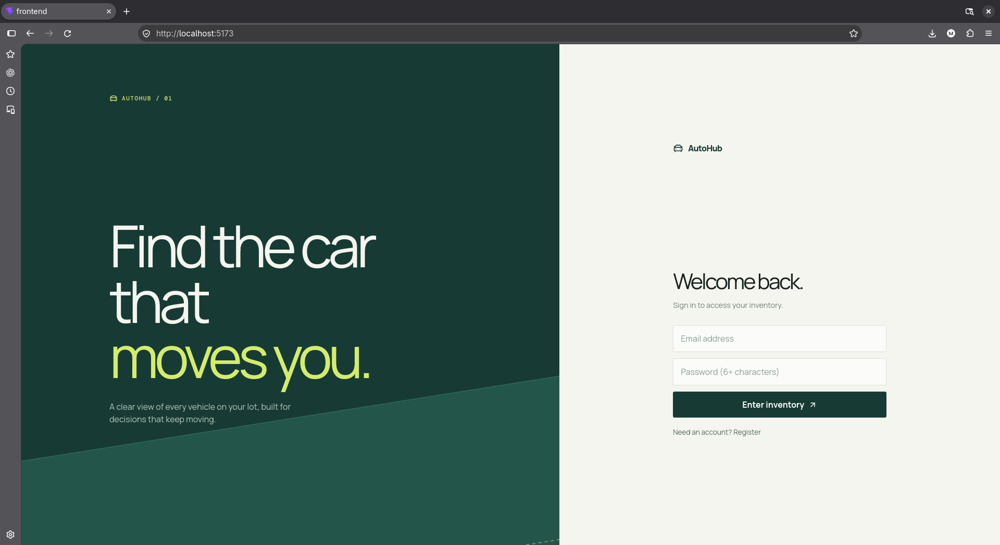
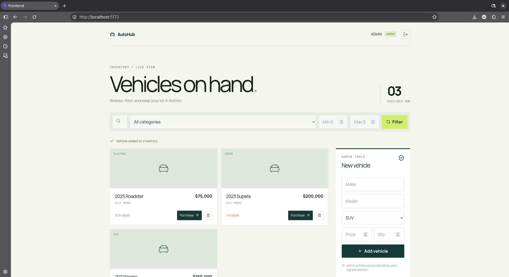
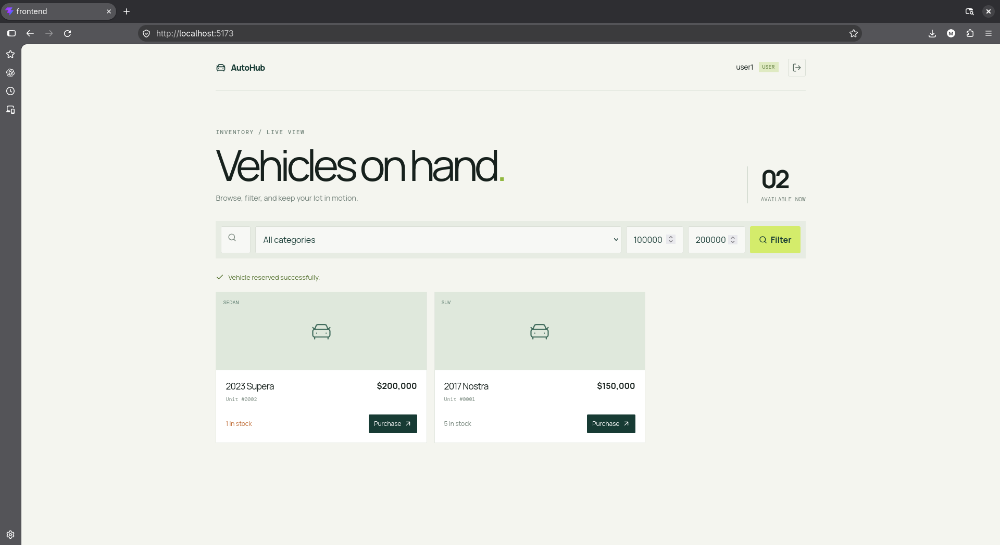

# AutoHub Dealership Inventory

AutoHub is a full-stack car dealership inventory system built for the Incubyte TDD assessment. The backend and frontend are intentionally separate packages connected through a REST API.

## Stack

- **Backend:** Node.js, JavaScript, Express, SQLite (`better-sqlite3`), JWT, bcryptjs
- **Frontend:** React, Vite, Tailwind CSS, Lucide React
- **Package manager:** PNPM
- **Testing:** Vitest and Supertest

## Features

- User registration and JWT login
- Protected vehicle listing and search by make, model, category, and price range
- Admin-only vehicle creation, update, and deletion
- Authenticated vehicle purchasing with atomic stock decrement
- Admin-only restocking
- Persistent SQLite database at `backend/data/inventory.db`
- Responsive dashboard with empty, error, loading, and out-of-stock states

## Run locally

Requirements: Node.js 20+ and PNPM 9+.

```bash
pnpm install
pnpm dev
```

The API runs on `http://localhost:3000` and the frontend on the Vite URL shown in the terminal, normally `http://localhost:5173`.

To run each package independently:

```bash
pnpm --filter dealership-inventory-api dev
pnpm --filter frontend dev
```

Copy `backend/.env.example` to `backend/.env` when customizing the port, JWT secret, or database path.

## Admin access

For this assessment build, registering the exact email `admin@autohub.test` creates an admin account. Any other registration creates a regular user. In production, admin provisioning would be handled by an invitation or protected back-office process.

## API summary

- `POST /api/auth/register`
- `POST /api/auth/login`
- `GET /api/vehicles`
- `GET /api/vehicles/search`
- `POST /api/vehicles` (admin)
- `PUT /api/vehicles/:id` (admin)
- `DELETE /api/vehicles/:id` (admin)
- `POST /api/vehicles/:id/purchase`
- `POST /api/vehicles/:id/restock` (admin)

Protected routes require `Authorization: Bearer <token>`.

## Tests and test report

The backend test suite follows a red-green-refactor shape around the API contract and covers duplicate registration, login, protected admin actions, searching, purchasing, out-of-stock behavior, and restocking.

Latest local result:

```text
Test Files  1 passed (1)
Tests       5 passed (5)
```

Run it with:

```bash
pnpm --filter dealership-inventory-api test
pnpm --filter frontend build
```

## Screenshots

1. Welcome Screen



2. Admin UI



3. User UI



## My AI Usage

I used GitHub Copilot during implementation to help structure the repository, draft API and React boilerplate, generate focused test cases, diagnose a SQLite test-isolation bug, and review the final setup documentation. I made the architectural choices, checked the endpoint behavior locally, and adjusted the implementation when tests exposed that `:memory:` had been resolved into a persistent filename.

AI helped reduce repetitive setup work and made it easier to iterate on the TDD surface quickly. It did not replace verification: the backend tests and production frontend build were run locally, and the resulting behavior was used to guide the final changes.

## Development notes

The API owns authentication, authorization, validation, inventory mutations, and persistence. The React app owns presentation and calls the API through `VITE_API_URL` (defaulting to `http://localhost:3000/api`). This keeps frontend and backend concerns separate and makes the API independently testable.
